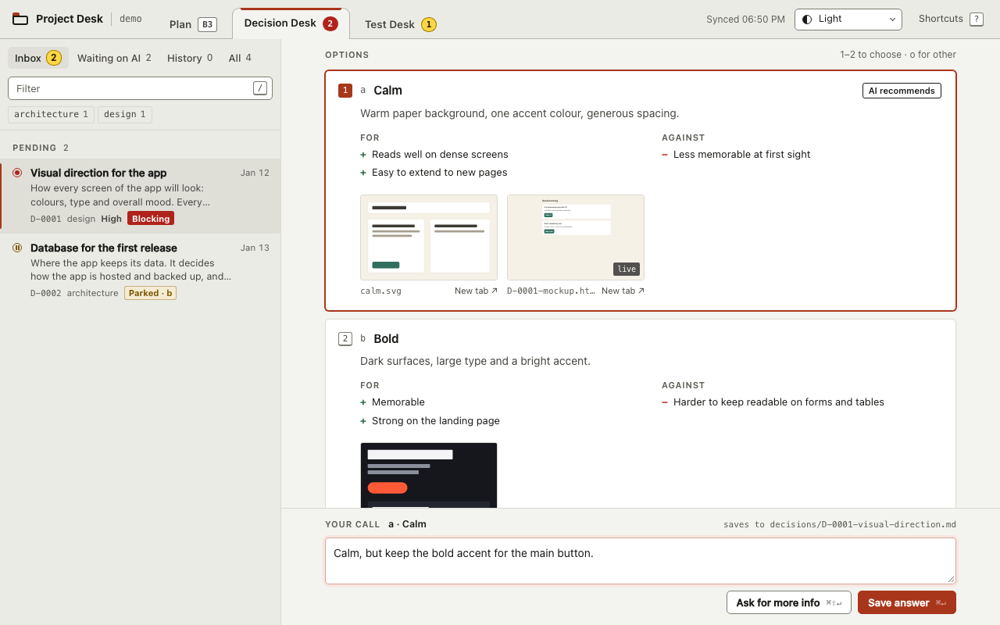
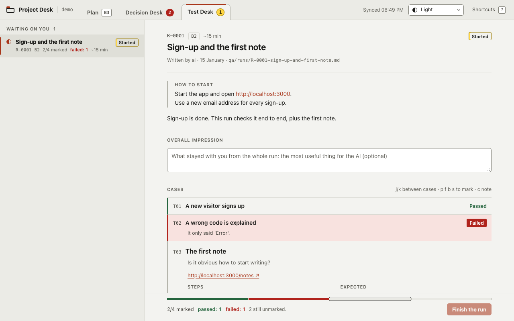

# Project Desk

A small local web app for working with an AI coding agent. The agent writes its questions, plan and
test checklists as files in your repo. You open them in the browser, answer, and the answer is saved
back into the same file for the agent to pick up.



It has three tabs:

- **Plan**: what is being built now, what is next, and what is waiting on you.
- **Decision Desk**: questions the agent should not decide alone (design, scope, data model, new
  dependencies). Each one has options, pros and cons, previews and the agent's recommendation. Pick
  one with a key, add a comment, save.
- **Test Desk**: short manual test runs. Walk them in your app, mark each case pass or fail, and the
  agent fixes what failed.

Everything is plain Markdown and YAML in your repo, so the history of every decision stays in git.
Runs on 127.0.0.1, no account, nothing is sent anywhere. Works with any agent that can read and write
files; Claude Code gets a hook and skills out of the box.

## Install

Requires Python 3.11+.

```sh
uv tool install git+https://github.com/kyrylo-kh/project-desk
# or: pipx install git+https://github.com/kyrylo-kh/project-desk
```

Just want to look? Clone the repo and run `make serve`: it opens the demo project.

## Use

In your project:

```sh
desk init --all --hook   # creates decisions/, plan/, qa/ and the Claude Code hook + skills
desk serve --open        # opens http://127.0.0.1:4700
```

Then work as usual:

1. The agent hits a decision it should not make alone and writes `decisions/D-0001-….md`.
   It keeps working on anything the decision does not block.
2. You open the Decision Desk, read it, press `1`/`2`/… to pick an option, add a comment if needed,
   `⌘↵` to save.
3. Next session, the agent sees the answer (via `desk summary` in the hook), applies it and marks the
   decision resolved.

Test runs work the same way: the agent writes `qa/runs/R-0001-….md`, you mark cases with
`p`/`f`/`b`/`s`, the agent processes the failures.

`desk init` never overwrites existing files. Without `--hook` it prints the hook snippet instead of
editing `.claude/settings.json`.

**Other agents** (Cursor, Codex, Aider…): point the agent at `decisions/README.md` and
`qa/README.md`. They describe when to ask, the file format and how to process answers. Add
`desk summary` to whatever runs at session start.



## Commands

| Command | |
|---|---|
| `desk serve --open` | Start the UI |
| `desk brief` | What is going on and what waits on you, in the terminal |
| `desk summary` | The same for the agent (used by the hook) |
| `desk new --title … --type … --group …` | Create the next decision file |
| `desk validate` | Check all files, exit 1 on errors |
| `desk list` | Table of decisions |

Press `?` in the UI for keyboard shortcuts.

## Docs

- [Configuration](docs/configuration.md): settings, all commands and keys, themes, Claude Code, Docker
- [File formats](docs/file-formats.md): decisions, plan, test runs, and what the desk writes
- [Writing a module](docs/modules.md): add your own tab
- [Architecture](docs/architecture.md)
- [Security](SECURITY.md)

## Development

```sh
make sync    # install with dev tools
make check   # ruff, mypy, pytest
make serve   # demo project in the browser
```

The browser render tests need Node 20.19+ or 22.7+; without it they are skipped.

## Licence

[FSL-1.1-ALv2](LICENSE.md): the Functional Source License with Apache 2.0 as the future licence.

- **Free to use** on any project, private or commercial, at work or for clients. You can read,
  change and share the code. Your files and code stay yours.
- **Not allowed:** offering Project Desk, or a product built on it, as a competing commercial
  product or service.
- **Two years after each release**, that release becomes plain [Apache-2.0](https://www.apache.org/licenses/LICENSE-2.0).

More about FSL: [fsl.software](https://fsl.software/).
